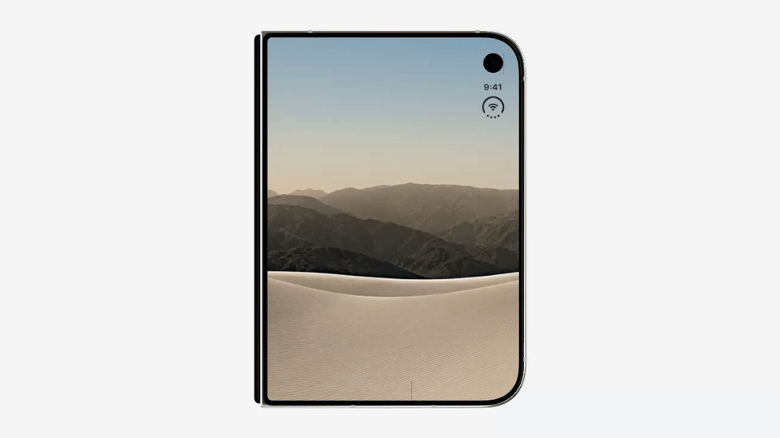
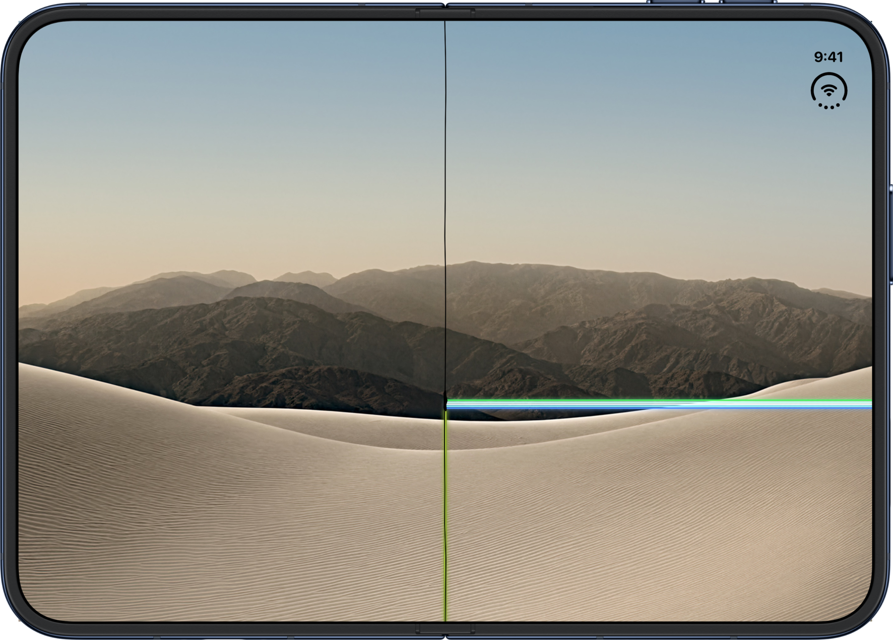
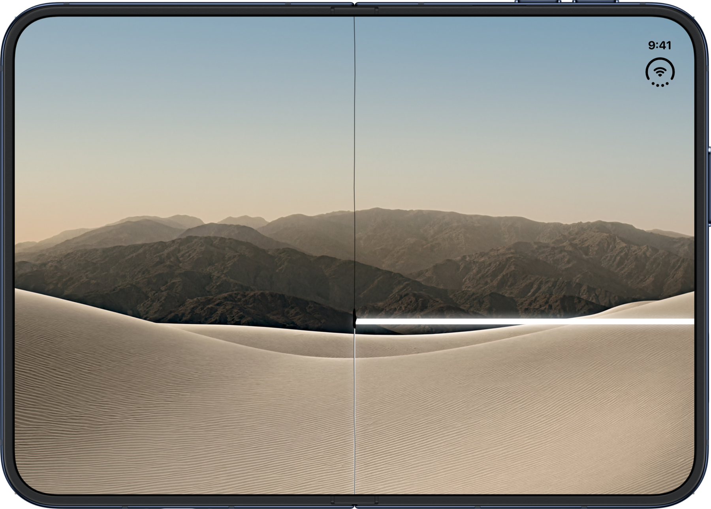
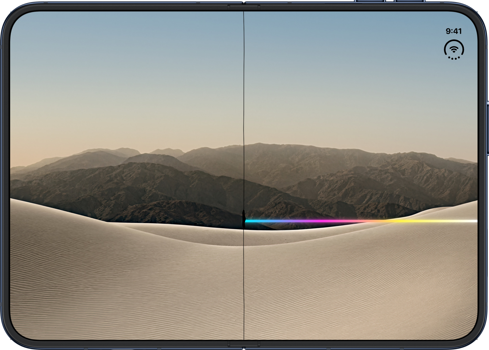
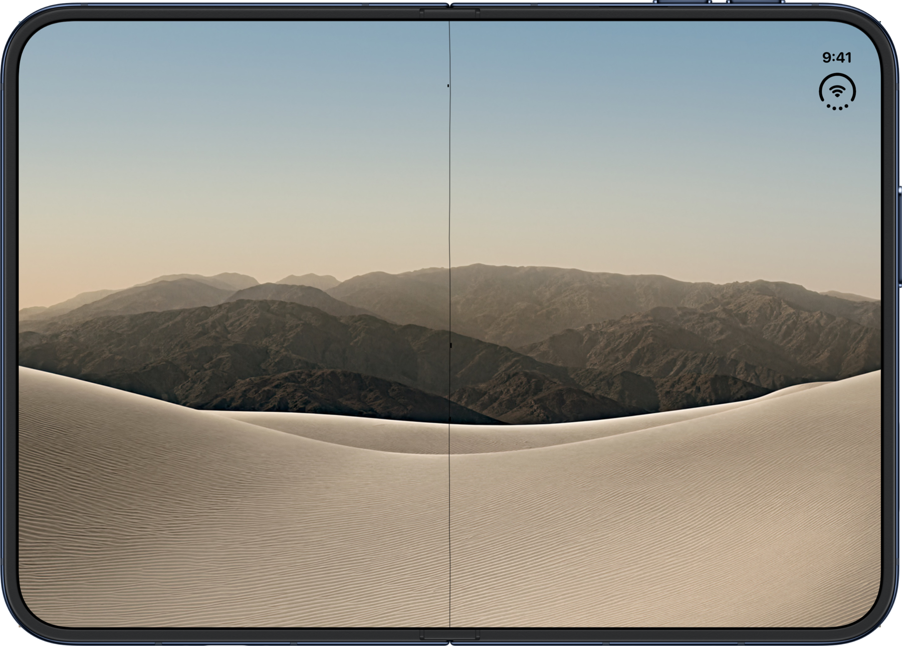
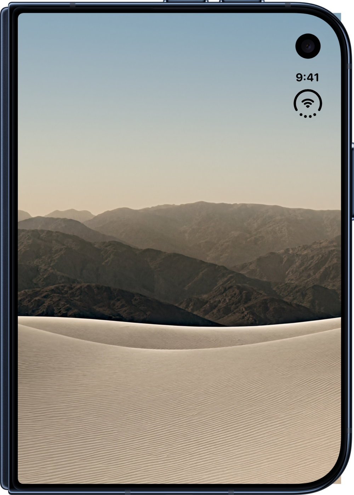
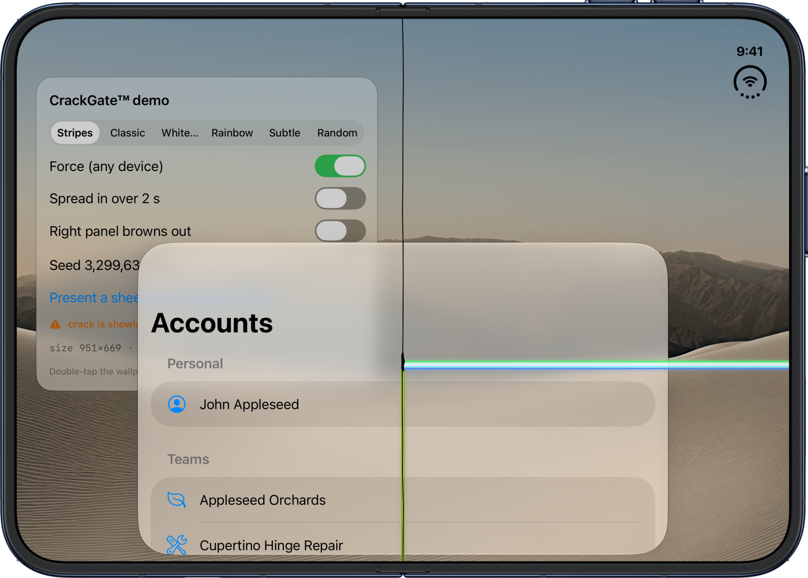
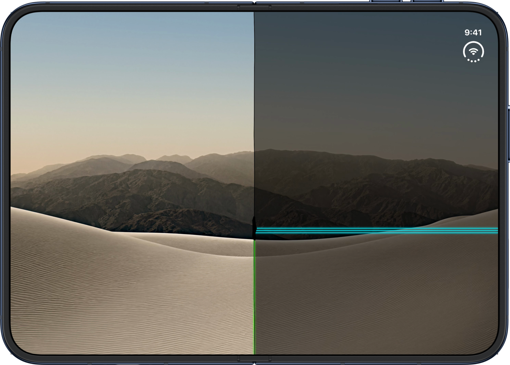

<p align="center">
  
</p>

<h1 align="center">CrackGate™</h1>

<p align="center">
  <b>a SwiftUI easter egg that gives your app the bad iPhone Duo unit.</b><br>
  fake hinge crack + stuck pixels, drawn only on the inner display, only when the phone is open.
</p>

<p align="center">
  
</p>

> **tl;dr** one line of SwiftUI. nothing happens on the outer screen, nothing happens on any other phone. open the Duo and your app has crackgate. it's an overlay, your screen is fine.

you know the photos. black crease down the hinge, a dead-pixel blob, a row of neon stuck pixels running off to the edge. now every app can have one. as a feature.

```swift
import CrackGate

ContentView()
    .crackGate()
```

that's it. that's the library.

## what it actually does

- draws the crack **only on an iPhone Duo with the hinge open**. inner display only, like the real thing. on every other phone, and on the outer screen, nothing happens. nobody will believe you until they unfold it.
- it finds the real fold position from the system (`reservedRegions`), so the crease lands exactly on the hinge, portrait or landscape.
- lives in its own window above sheets, alerts and full screen covers.
- same seed = same crack every launch. a user gets *their* unit. forever.
- touches go straight through. VoiceOver never sees it. Reduce Motion turns off the flicker.

## the units

| `.stripes` (default) | `.classic` |
|:--:|:--:|
|  |  |
| the home screen one. bright band at the fold + lime line down | the lock screen one. three cyan rows + green line |

| `.whiteBar` | `.rainbow` |
|:--:|:--:|
|  |  |
| the dark lock screen one. thick glowing white bar | the software update one |

| `.subtle` | folded |
|:--:|:--:|
|  |  |
| just the crease and a few dead pixels. for the patient | outer screen. nothing. that's the joke |

```swift
.crackGate(.stripes)      // default
.crackGate(.random)       // the lottery. stable per seed, so a user keeps their unit
.crackGate(.custom(spec)) // make your own, god help you
```

it also sits on top of your sheets and alerts, because a dead row of pixels does not care about your modal:

<p align="center"></p>

## options

```swift
.crackGate(
    .stripes,
    trigger: .innerDisplay,          // default. or .always / .never / .when(flag)
    onset: .after(.seconds(30)),     // or .immediate / .spreading(.seconds(2))
    presentation: .window,           // or .inline if you want it under your sheets
    seed: 7
)
```

`.always` is for demos, previews and screenshots. `.when(isAprilFirst)` is for cowards.

want the far half of the panel to brown out too, like in the video? that's a thing, and it listens to the hinge:

```swift
.crackGate(.stripes.panelDim())           // flickers dark now and then. flex the phone → flickers worse. bend it → keeps going until flat
.crackGate(.stripes.panelDim(.flicker))   // timer only, ignores the hinge
.crackGate(.stripes.panelDim(.constant))  // the right half just stays dim. grim
```

push it hard enough and the stuck rows jump across the whole screen for a moment. it looks real. that's the point.

<p align="center"></p>

want to play along? there's an environment value:

```swift
@Environment(\.crackGateIsActive) var cracked
// show a fake "Software Update" card. you monster.
```

there's also `CrackGateOverlay` if you want to put the crack somewhere yourself.

## install

swift package manager. add this repo. iOS 26+, the hinge stuff is iOS 27.1 and gated, so on 26 it just never fires (unless you force it).

## demo

`Demo/project.yml` → `xcodegen generate` → run on the iPhone Duo simulator. drop a wallpaper into `Assets.xcassets/Wallpaper.imageset` or keep the fake dunes.

## disclaimers, sort of

- it's an overlay. it cannot hurt your screen. please stop emailing
- it will absolutely confuse your users
- the app might got rejected lol
- not affiliated with apple, the hinge, or anyone who bought one on launch day

MIT.
